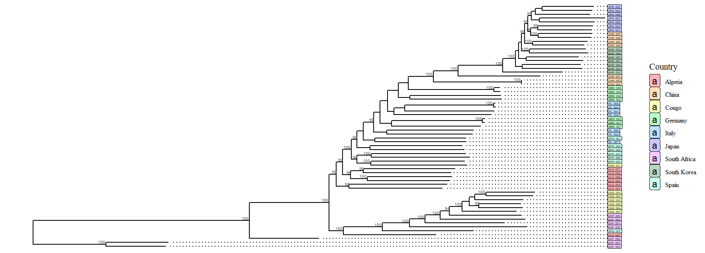
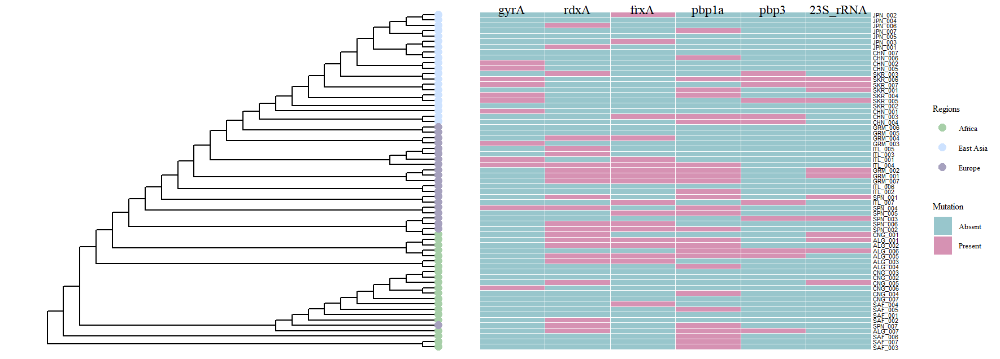
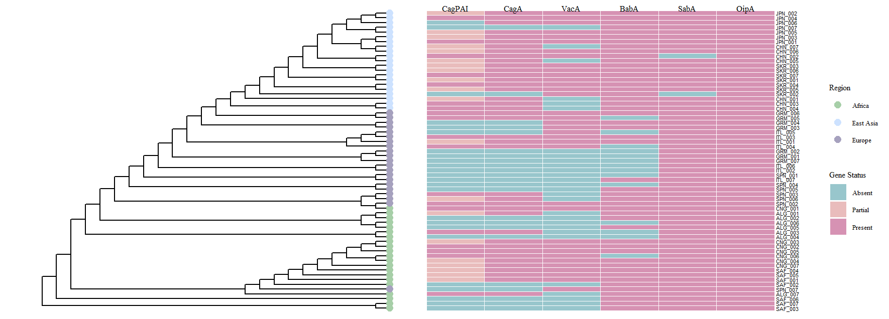

# Helicobacter pylori Comparative Genomics

 ## Overview
This project performs comparative genomics analysis of 63 *Helicobacter pylori* strains — 7 strains per country across 9 countries representing 3 geographic regions (Africa, East Asia, and Europe) — with *H. acinonychis* as an outgroup.

## Data Source
Genomes were downloaded from NCBI RefSeq/GenBank (accessions and sample IDs in [metadata.tsv](Genome/metadata.tsv)).
Majority of genomes are from the *H. pylori* Genome Project (HpGP) (Thorell K, Muñoz-Ramírez ZY, Wang D, et al. The *Helicobacter pylori* Genome Project: insights into *H. pylori* population structure from analysis of a worldwide collection of complete genomes. *Nat Commun*. 2023;14(1):8184. doi:10.1038/s41467-023-43562-y); the rest are from independent studies.

**Regions and countries:**
- Africa: Algeria, Congo, South Africa
- East Asia: China, Japan, South Korea
- Europe: Germany, Italy, Spain

**Pipeline summary:**
- Genome annotation: Prokka
- Pangenome analysis: Panaroo
- Phylogenetic reconstruction: IQ-TREE
- AMR detection: AMRFinderPlus + RGI/CARD
- Virulence factor detection: ABRicate/VFDB
- Visualization: R (ggtree, gheatmap)

## 1. Genome Download & Quality Control

Genomes were downloaded from NCBI GenBank using the accession list: [accession.txt](Genome/accession.txt)

```bash
datasets download genome accession --inputfile accession.txt --include genome --filename accession.txt
```

Strains were renamed according to [rename.txt](Genome/rename.txt):


Quality check was performed using SeqKit:

```bash
seqkit stats -a -T *.fna > seq_qc_genomes.txt
```

## 2. Genome Annotation

All genomes were annotated using Prokka:

```bash
    prokka \
        --outdir Annotation/sample \
        --prefix sample \
        --genus Helicobacter \
        --species pylori \
        --kingdom Bacteria \
        --gcode 11 \
        --cpus 4 \
        sample.fna
```

Results: [Annotation/](Annotation/)

## 3. Pangenome Analysis

Pangenome was constructed using Panaroo in strict mode:

```bash
panaroo -i annotation/*/*.gff \
    -o Pangenome \
    --clean-mode strict \
    -a core \
    --aligner mafft \
    --core_threshold 0.95 \
    -t 6
```

Results: [Pangenome/](Pangenome/)

## 4. Phylogenetic Analysis

Maximum likelihood phylogenetic tree was constructed using IQ-TREE:

```bash
iqtree -s Pangenome/core_gene_alignment_filtered.aln \
    -m MFP \
    -B 1000 \
    -bnni \
    -alrt 1000 \
    -T AUTO
```

Tree was rooted using *H. acinonychis* as outgroup. Results: [Phylogeny/](Phylogeny/)

## 5. AMR Analysis

### AMRFinderPlus
Point mutations and AMR genes detected using AMRFinderPlus:

```bash
  amrfinder \
    -n fna/sample.fna \
    -p faa/sample.faa \
    -g gff/sample.gff \
    -O Helicobacter_pylori \
    --plus \
    --threads 4 \
    -o sample_amr.tsv
```

### RGI/CARD
Resistant gene mutation identified using RGI with CARD database:

```bash
    rgi main \
        --input_sequence sample.fna \
        --output_file result/sample_rgi \
        --local \
        --clean 
```

Results: [Amr/](Amr/)

## 6. Virulence Factor Analysis

Virulence factors detected using ABRicate with VFDB:

```bash
    abricate --db vfdb sample.fna > vfdb/sample_vfdb.tsv
```

Results: [Virulence/](Virulence/)

## 7. Visualization

Phylogenetic tree and heatmaps were generated in R using ggtree and gheatmap.

R scripts: [Visualization/scripts/](Visualization/scripts/)

## Results

The genome sizes ranged from 1555420.0 bp to 1725063.0 bp and the average GC content was 38.9%

### Pan-genomes

Panaroo pan-genome analysis of 63 H. pylori strains identified a total of 2,847 genes. Of these, 1,192 were core genes (present in ≥99% of strains), 67 soft-core (95–99%), 388 shell (15-95%), and 1,200 cloud genes (<15%). H. pylori has an open pan-genome, despite sharing a highly conserved core genome strains exhibit considerable diversity driven by constant genetic recombination and horizontal gene transfer.

### Phylogenetic reconstruction 


*Maximum likelihood phylogenetic tree of H. pylori strains rooted with H. acinonychis, tip labels colored by country.*

The tree revealed two primary lineages: one comprising South African and Congolese strains, and a second encompassing European, Algerian, and East Asian strains. East Asian strains (JPN, SKR, CHN) formed a tight, well supported clade with notably short branch lengths. South African strains showed comparatively longer branch lengths, which could be due to greater sequence diversity within these strains. European strains clustered together in a distinct clade, with Algerian strains grouping within this clade rather than with African strains, possibly reflecting historical gene flow across the Mediterranean. SPN_007 clustered within the African lineage and CNG_001 clustered with European strains, could be due to potential Africa-Europe admixture, consistent with patterns reported in H. pylori population studies.

### Antimicrobial Resistance


*Distribution of AMR genes and point mutations across strains mapped onto phylogeny.*

AMR analysis identified resistance-associated mutations across six loci. Mutations in gyrA confer fluoroquinolone resistance, rdxA and frxA are associated with metronidazole resistance, pbp1a and pbp3 with beta-lactam resistance, and 23S rRNA mutations with clarithromycin resistance. AMR gene and mutations were manually curated keeping only variants with confirmed associations with antibiotic resistance.

### Virulence


*Distribution of virulence factors across strains mapped onto phylogeny.*

Virulence factor analysis was performed across six loci: CagPAI, CagA, VacA, BabA, SabA, and OipA. CagA is the primary virulence effector of H. pylori, injected directly into gastric epithelial cells via the Type IV Secretion System (T4SS) encoded by the cag pathogenicity island (CagPAI), where it disrupts host cell signalling and promotes inflammation. VacA is a secreted cytotoxin that induces vacuolation and apoptosis in host cells. BabA mediates adherence to gastric epithelial cells by binding blood group antigens. SabA and OipA are outer membrane proteins involved in adhesion and inflammatory signalling respectively; notably, both are phase-variable genes whose expression can be switched on or off independent of gene presence, meaning detection does not necessarily indicate activity. Functional CagPAI was defined by the presence of all essential cagPAI genes, while strains lacking one or more core components, including virB10/cagY which encodes a critical outer membrane component of the T4SS required for CagA translocation, were classified as harbouring partial or disrupted cagPAI. East Asian and African strains showed comparatively higher overall virulence factor prevalence than European strains, consistent with patterns reported in the literature. VacA showed low detection across strains, likely reflecting allelic diversity in the vacA gene, particularly mosaic s and m region alleles, that may fall below the 80% coverage threshold applied. A lower threshold was not used to avoid false positive detections. Wet lab validation would be required to confirm the true virulence potential of these strains.


## Tools & Versions
| Tool | Version |
|------|---------|
| NCBI Datasets CLI | 18.30.1 |
| SeqKit | 2.3.0 |
| Prokka | 1.12 |
| Panaroo | 1.7.0 |
| IQ-TREE | 3.1.2 |
| AMRFinderPlus | 4.2.7 |
| RGI | 6.0.8 |
| CARD database | 4.0.1 |
| ABRicate | 1.4.0 |
| R | 4.5.2 |
| ggtree | 4.0.5 |
| ggplot2 | 4.0.3 |
| ape | 5.8.1 |


